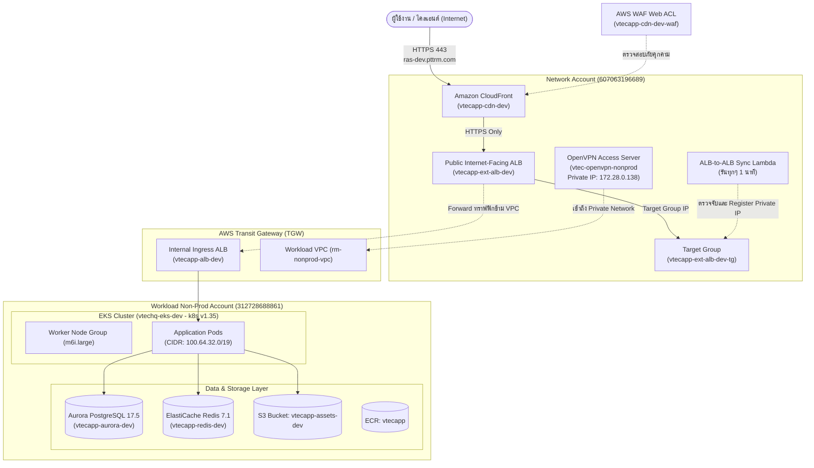

# รายงานสรุปทรัพยากรระบบ AWS (ฉบับภาษาไทยโดยละเอียด)
## โครงการ: PTTRM VTEC JIFFY POS — สภาพแวดล้อมเพื่อการพัฒนา (DEV Environment)

* **จัดทำโดย**: DailiTech Co., Ltd. (AWS Advanced Consulting Partner)
* **เวอร์ชันเอกสาร**: Version 1.5 (ส่งมอบและตรวจสอบล่าสุด: 26 ตุลาคม 2026)
* **อ้างอิงเอกสารต้นฉบับ**: `PTTRM VTEC JIFFY POS_ Resource Summary (DEV)-v11-20261026_120457.pdf`
* **ระบบจัดการโครงสร้างพื้นฐาน (IaC)**: Terraform State + AWS Resources

---

## 1. บทนำและข้อมูลบัญชี AWS (Scope & Account Information)

ระบบงานนี้เป็นสภาพแวดล้อม **Development (DEV)** สำหรับระบบ **PTTRM VTEC JIFFY POS** ติดตั้งใน **AWS Region ap-southeast-7 (Asia Pacific — Bangkok)** โดยยกเว้นเฉพาะ AWS WAF ที่ผูกกับ CloudFront ซึ่งต้องอยู่ใน Region `us-east-1` (Global Scope) ตามข้อกำหนดของ AWS 

การออกแบบโครงสร้างบัญชีใช้แนวคิด **Multi-Account Architecture** ตามหลัก AWS Well-Architected Framework เพื่อแยกความรับผิดชอบ (Separation of Duties) และจำกัดขอบเขตความเสี่ยงด้านความปลอดภัย (Blast Radius):

| บัญชี AWS (Account Name) | Account ID | AWS Profile | หน้าที่รับผิดชอบ |
| :--- | :--- | :--- | :--- |
| **Workload Non-Prod Account** | `312728688861` | `pttrm-nonprod` | รันแอปพลิเคชันหลักบน EKS Cluster, ฐานข้อมูล Aurora PostgreSQL, Cache Redis และ S3 Assets |
| **Network Account** | `607063196689` | `pttrm-network` | ดูแลเครือข่ายด่านหน้า (Ingress Edge), CloudFront, WAF, Public ALB และ OpenVPN Gateway สำหรับเชื่อมต่อระยะไกล |

---

## 2. แผนผังสถาปัตยกรรมและการไหลของทราฟฟิก (Traffic Flow Architecture)

ระบบใช้การส่งต่อข้อมูลแบบหลายระดับ (Multi-Tier) และข้ามบัญชี (Cross-Account Boundary) จากภายนอกเข้าสู่ Container ภายในอย่างรัดกุม:



### 2.1 ลำดับการส่งคำขอ (Request Flow)
1. **ผู้ใช้งานภายนอก (Internet)** เข้าใช้งานผ่าน URL: `https://ras-dev.pttrm.com`
2. คำขอส่งมายัง **Amazon CloudFront (`vtecapp-cdn-dev`)** พร้อมตรวจสอบความปลอดภัยผ่าน **AWS WAF (`vtecapp-cdn-dev-waf`)**
3. CloudFront ส่งต่อคำขอผ่าน HTTPS ไปยัง **Public ALB (`vtecapp-ext-alb-dev`)** ที่ฝั่ง Network Account
4. **ALB-to-ALB Sync Lambda**: เนื่องจาก Ingress ALB ฝั่ง EKS เป็นแบบ Internal และมี IP ที่เปลี่ยนแปลงได้ตามการ Scale ของ AWS ฟังก์ชัน Lambda จะทำงานทุก 1 นาที เพื่อค้นหา IP ของ Ingress ALB แล้วลงทะเบียน (Register) เข้ากับ Target Group ของ Public ALB อัตโนมัติ (ปัจจุบัน Sync สำเร็จ 3 IPs: `172.28.10.145`, `172.28.10.20`, `172.28.10.91`)
5. ทราฟฟิกวิ่งข้ามโครงข่ายไปยัง **Internal Ingress ALB (`vtecapp-alb-dev`)** ภายใน Workload Account
6. Ingress ALB ส่งต่อคำขอเข้าสู่ **EKS Pods** ตามการกำหนด Routing ของทีมพัฒนา

### 2.2 การตั้งค่า DNS (DNS Records Configuration)
* **สิ่งที่ลูกค้าต้องดำเนินการ (Customer Action Needed)**:
  * มีเพียงรายการเดียวเท่านั้น คือเพิ่มเรคคอร์ด CNAME ในระบบ DNS ของลูกค้า:
    * **Host / Record**: `ras-dev.pttrm.com`
    * **Record Type**: `CNAME`
    * **Value**: `d2jtcqzr2d6dnv.cloudfront.net`
    * **ข้อสังเกต**: ต้องใช้ตัวอักษรพิมพ์เล็กทั้งหมด (Lowercase) ตามข้อบังคับของ CloudFront
* **เรคคอร์ดของ Ingress ALB และ Public ALB**: สร้างขึ้นโดย AWS อัตโนมัติ ลูกค้า**ไม่ต้องชี้ DNS ใดๆ** เข้าหา ALB โดยตรง

---

## 3. สถาปัตยกรรมโครงข่าย (Networking Architecture)

ระบบเครือข่ายเป็นแบบ Shared VPC ผ่าน AWS Resource Access Manager (RAM) โดยมีรายละเอียดดังนี้:

* **VPC หลัก (Workload)**: `vpc-0f45a0034beb15958` (`rm-nonprod-vpc`)
  * **VPC Primary CIDR**: `172.28.10.0/23`
  * **Pod Secondary CIDR**: `100.64.32.0/19` (ใช้ร่วมกับ **AWS VPC CNI Custom Networking** เพื่อแยกวง IP สำหรับ Pods ไม่ให้แย่งชิง IP วงหลักขององค์กร)
* **การกระจาย Subnet (ครอบคลุม 3 Availability Zones: a, b, c)**:
  * **App Subnets (สำหรับ EKS Worker Nodes)**:
    * Zone A: `subnet-02b7b285520931989`
    * Zone B: `subnet-026f8e36089bbd09e`
    * Zone C: `subnet-0057282cda9c09879`
  * **Secure Subnets (สำหรับ Database Aurora & Redis Cache)**:
    * Zone A: `subnet-059377336d693204c`
    * Zone B: `subnet-0ca627725499aa71b`
    * Zone C: `subnet-0a1b982b1f513ca22`
  * **Non-expose Subnets (สำหรับ EKS Pod IPs โดยเฉพาะ)**:
    * Zone A: `subnet-024984c096fc3c168`
    * Zone B: `subnet-023499c582c988934`
    * Zone C: `subnet-0d1831db4ec285fb7`

---

## 4. รายละเอียดทรัพยากรหลัก (Resource Summary)

### 4.1 ระบบประมวลผลคอนเทนเนอร์ (Amazon EKS)
* **ชื่อคลัสเตอร์**: `vtechq-eks-dev`
* **เวอร์ชัน Kubernetes**: **1.35** (Node AMI v1.35.9 อัปเกรดต่อเนื่องจาก 1.31 -> 1.32 -> 1.33 -> 1.34 -> 1.35)
* **Endpoint Access**: **Private Only (`Public = false, Private = true`)** ยกระดับความปลอดภัยขั้นสูงสุด เข้าถึงเพื่อรัน `kubectl` ได้ผ่าน VPN เท่านั้น
* **Node Group ("general")**:
  * สถานะ: `ACTIVE`
  * สเปก Instance: `m6i.large` (2 vCPU, 8 GiB RAM)
  * ระบบปฏิบัติการ: **Amazon Linux 2023 (`AL2023_x86_64_STANDARD`)**
  * Auto Scaling: Min = 1, Max = 1, Desired = 1
  * รองรับ IMDSv2 และ Storage เป็น EBS `gp3`
* **EKS Managed Add-ons (รองรับ v1.35 ทั้งหมด)**:
  1. `vpc-cni` v1.22.4-eksbuild.8 (เปิดใช้งาน Custom Networking + Prefix Delegation)
  2. `kube-proxy` v1.35.3-eksbuild.59
  3. `coredns` v1.13.2-eksbuild.59
  4. `aws-ebs-csi-driver` v1.67.2-eksbuild.1 (*สำคัญ: Service Account ต้องผูกกับ IRSA Role ARN `vtechq-eks-dev-ebs-csi-role` เพื่อป้องกัน CrashLoopBackOff*)
  5. `metrics-server` v0.7.2-eksbuild.18
  6. `amazon-cloudwatch-observability` v6.7.0-eksbuild.1
  7. `AWS Load Balancer Controller` (ติดตั้งผ่าน Helm)
* **EKS Access Entries (การจัดการสิทธิ์)**:
  * `RMAdminRole` และ `RMDevOpsRole` ได้รับนโยบาย `AmazonEKSClusterAdminPolicy`
  * `RMReadOnlyRole` ได้รับนโยบาย `AmazonEKSViewPolicy`
* **Ingress ALB (`vtecapp-alb-dev`)**:
  * โหลดบาลานเซอร์ภายใน (Internal Scheme) บริหารจัดการโดย AWS Load Balancer Controller โดยตรง (อยู่นอกเหนือการจัดการของ Terraform State) มีการสร้าง Ingress Placeholder รอไว้ล่วงหน้า

### 4.2 ระบบจัดเก็บข้อมูลและฐานข้อมูล (Data & Storage)
* **Amazon Aurora PostgreSQL (`vtecapp-aurora-dev`)**:
  * **Engine**: Aurora PostgreSQL เวอร์ชัน 17.5
  * **ขนาด**: `db.t4g.medium` (1 Writer, 0 Reader - Single AZ สำหรับ DEV)
  * **การเชื่อมต่อ**: Port `5432` / Database: `vtechq` / Master User: `vtecpos`
  * **ความปลอดภัยและการสำรองข้อมูล**: Retention 7 วัน, เข้ารหัสข้อมูล At-Rest
  * **Security Group**: `sg-01c76e32b7f1b0cdf` อนุญาตทราฟฟิกพอร์ต 5432 จาก EKS Node SG และ OpenVPN Gateway IP (`172.28.0.138/32`)
* **Amazon ElastiCache for Redis (`vtecapp-redis-dev`)**:
  * **Engine**: Redis เวอร์ชัน 7.1 (Cluster Mode: Disabled)
  * **ขนาด**: `cache.t4g.small` (1 โหนด)
  * **การเชื่อมต่อ**: Port `6379`
  * **ความปลอดภัย**: เปิดใช้งาน In-Transit Encryption (TLS), At-Rest Encryption และเปิดใช้งาน AUTH Token
  * **Security Group**: `sg-0d09ebce810b2fe49` อนุญาตพอร์ต 6379 จาก EKS Node SG และ OpenVPN Gateway IP
* **Amazon ECR (`vtecapp`)**:
  * Image Tag Immutability: เปิดใช้งาน (ห้ามเขียนทับ Tag)
  * Scan on push: เปิดใช้งาน (สแกนหา CVEs อัตโนมัติเมื่อพุชอิมเมจ)
  * การเข้ารหัส: AES256
  * Lifecycle Policy: เก็บ Image ล่าสุด 20 รายการ
* **Amazon S3 (`vtecapp-assets-dev`)**:
  * การเข้ารหัส: SSE-KMS (`aws/s3`)
  * ปิดการเข้าถึงสาธารณะ 100% (Block all public access)

### 4.3 ระบบเครือข่ายด่านหน้าและความปลอดภัย (Edge & Security Layer)
* **Public ALB (`vtecapp-ext-alb-dev`)**:
  * วางอยู่ใน Network VPC (Untrust Subnets)
  * Port 80 ทำ Redirect ไป Port 443
  * Port 443 ตรวจสอบ Host Header `ras-dev.pttrm.com` ส่งต่อเข้า Target Group (IPs ของ Ingress ALB)
  * ใบรับรอง SSL/TLS: ดึงจาก AWS Certificate Manager (ACM) ใน Region `ap-southeast-7`
* **Amazon CloudFront Distribution (`vtecapp-cdn-dev`)**:
  * Domain: `d2jtcqzr2d6dnv.cloudfront.net`
  * Alternate Domain (CNAME): `ras-dev.pttrm.com`
  * Custom SSL Certificate: ACM ใน Region `us-east-1` (ตามข้อกำหนดของ CloudFront)
  * การแคช: `Managed-CachingOptimized` / `Managed-AllViewer`
* **AWS WAF (`vtecapp-cdn-dev-waf`)**:
  * ติดตั้งในขอบเขต Global (`us-east-1`)
  * กฎป้องกัน: IP Whitelist, IP Blacklist, Anonymous IP List, Amazon IP Reputation List, Core Rule Set (CRS) และ SQL Injection Rules

---

## 5. การเข้าถึงระยะไกลผ่าน OpenVPN (OpenVPN Access Server)

OpenVPN ติดตั้งใน Network Account เพื่อให้นักพัฒนาและผู้ดูแลระบบสามารถเข้าถึงคลัสเตอร์ EKS ที่เป็น Private Endpoint และเชื่อมต่อกับ Database ได้โดยตรง:

* **Instance Name**: `vtec-openvpn-nonprod` (`i-08c83864c0bcda437`)
* **Public IP (Elastic IP)**: `43.209.188.148`
* **Private IP**: `172.28.0.138`
* **หลักการทำงานของ Source NAT (SNAT)**:
  * OpenVPN Access Server จะทำการ NAT ทราฟฟิกของผู้ใช้งานทั้งหมดให้เสมือนออกมาจาก Private IP `172.28.0.138`
  * ทำให้การตั้งค่า Security Group ภายใน ไม่จำเป็นต้องระบุวง IP ย่อยของ VPN ไคลเอนต์ แต่สามารถ Whitelist เฉพาะ IP `172.28.0.138/32` ได้ทันที

### 5.1 คู่มือขั้นตอนการเชื่อมต่อสำหรับผู้ใช้งาน (How to Connect)
1. เปิดเว็บบราวเซอร์ไปยัง OpenVPN Admin/Client Portal: `https://43.209.188.148/` (กดยอมรับคำเตือน Certificate)
2. เข้าสู่ระบบด้วย Username: `openvpn` (รหัสผ่านจัดส่งผ่านช่องทางความปลอดภัยแยกต่างหาก)
3. ดาวน์โหลด Client Profile (`.ovpn`) หรือติดตั้งโปรแกรม **OpenVPN Connect** แล้ว Import Profile เข้าสู่โปรแกรม
4. ทำการกดเชื่อมต่อ (Connect) เพื่อสร้าง VPN Tunnel เข้าสู่เครือข่ายภายใน
5. สำหรับผู้ดูแลระบบที่ต้องการสั่งงาน EKS ผ่าน CLI ให้รันคำสั่ง:
   ```bash
   aws eks update-kubeconfig --name vtechq-eks-dev --region ap-southeast-7 --profile pttrm-nonprod
   ```
   *หมายเหตุ: สิทธิ์การเข้าถึง Kubernetes จะถูกตรวจสอบผ่าน IAM Role ตามนโยบาย EKS Access Entry (`RMAdminRole` / `RMDevOpsRole` / `RMReadOnlyRole`)*

---

## 6. การจัดการรหัสผ่านและความลับ (Secrets Management)

ความลับทั้งหมดถูกจัดเก็บไว้ใน **AWS Secrets Manager** ภายใน Workload Account:

| ชื่อ Secret | ค่าที่จัดเก็บ | ผู้ดูแลและสร้าง (Managed By) | การหมุนเวียน (Rotation) | นโยบายความปลอดภัย |
| :--- | :--- | :--- | :--- | :--- |
| **Aurora Master Password** | รหัสผ่านผู้ใช้ `vtecpos` สำหรับ Aurora DB | จัดการโดย AWS RDS Service (`manage_master_user_password`) | หมุนเวียนอัตโนมัติ (Auto / AWS-managed) | ค่ารหัสผ่านไม่ปรากฏใน Terraform State ใดๆ แอปพลิเคชันอ่านผ่าน ARN โดยตรง |
| **Redis Auth Token** | Auth Token สำหรับเข้าใช้งาน Redis Cluster | จัดการโดย Terraform (`random_password`) | กำหนดด้วยตนเอง (Manual/Self-managed) | รหัสผ่านถูกบันทึกลงใน Terraform State ที่ถูกเข้ารหัสบน S3 Backend |

---

## 7. ข้อควรระวังและแนวทางการดูแลรักษาระบบ (Architectural & Operational Notes)

1. **ความแตกต่างระหว่างการตั้งค่า Security Group ผ่าน Terraform และ AWS CLI**:
   * **พอร์ต EKS API 443**: กฎที่เปิดให้ VPN Gateway (`172.28.0.138/32`) เข้าถึง เป็นการเพิ่มผ่าน **AWS CLI** เข้าที่ Managed Security Group ของ EKS โดยตรง (`sg-007b64e9956a2855d`) ซึ่งไม่อยู่ใน State ของ Terraform ห้ามพยายามนำเข้าหรือแก้ไขผ่านโค้ดทั่วไป
   * **พอร์ต Aurora (5432) และ Redis (6379)**: จัดการผ่าน **Terraform** ด้วยตัวแปร `onprem_cidr_blocks = ["172.28.0.138/32"]` **ห้ามเพิ่มกฎผ่าน AWS CLI ด้วยตนเอง** เพราะหากมีการรัน `terraform apply` กฎที่ทำผ่าน CLI จะถูกเขียนทับทันที
2. **การอัปเกรด EKS Add-ons**:
   * โมดูล Terraform มีการระบุ `ignore_changes = all` เอาไว้ เพื่อให้ทีม Cloud Engineer สามารถอัปเกรดเวอร์ชันของ Add-ons ผ่าน CLI/Console ได้อย่างยืดหยุ่น โดยไม่ส่งผลกระทบให้เกิด Configuration Drift ใน Terraform
3. **Bastion Host**:
   * มีโค้ดเตรียมไว้แต่ถูกปิดการใช้งานอยู่ (`enable_bastion = false`) เนื่องจากใช้ OpenVPN เป็นช่องทางหลักในการเข้าถึง

---

## 8. บันทึกผลการทดสอบและตรวจรับระบบ (Verification Checklist)

ผลการทดสอบการติดตั้งทรัพยากรทุกรายการบนสภาพแวดล้อม DEV อยู่ในสถานะ **ผ่านการทดสอบทั้งหมด (PASS 100%)**:

| รหัสทดสอบ | รายการทดสอบ (Test Case) | เป้าหมายทรัพยากร (Target) | ผลการทดสอบ (Status) |
| :---: | :--- | :--- | :---: |
| **TC-01** | EKS Cluster ออนไลน์ และ Node Group อยู่ในสถานะ ACTIVE | `vtechq-eks-dev` | **PASS** |
| **TC-02** | Ingress ALB พร้อมใช้งาน (Active) | `vtecapp-alb-dev` | **PASS** |
| **TC-03** | ECR Repository ออนไลน์ พร้อมรับ Image | `vtecapp` | **PASS** |
| **TC-04** | Aurora PostgreSQL Cluster ออนไลน์ | `vtecapp-aurora-dev` | **PASS** |
| **TC-05** | ElastiCache Redis Cluster ออนไลน์ | `vtecapp-redis-dev` | **PASS** |
| **TC-06** | S3 Assets Bucket เข้าถึงได้ถูกต้อง | `vtecapp-assets-dev` | **PASS** |
| **TC-07** | Public ALB ออนไลน์และพร้อมรับคำขอ | `vtecapp-ext-alb-dev` | **PASS** |
| **TC-08** | Lambda Sync ALB-to-ALB ทำงานตามรอบเวลา (Sync 3 IPs สมบูรณ์) | `vtecapp-ext-alb-dev-a2a` | **PASS** |
| **TC-09** | CloudFront Distribution อยู่ในสถานะ Deployed และ Enabled | `vtecapp-cdn-dev` | **PASS** |
| **TC-10** | AWS WAF ติดตั้งและป้องกัน CloudFront ตามกฎครบถ้วน | `vtecapp-cdn-dev-waf` | **PASS** |
| **TC-11** | OpenVPN เชื่อมต่อได้ พร้อมเปิด Security Group ไปยัง EKS API, Aurora และ Redis | `vtec-openvpn-nonprod` | **PASS** |

---

## 9. ประวัติการปรับปรุงเอกสาร (Changelog Summary)

* **v1.0 (22 ต.ค. 2026)**: เริ่มต้นสรุปทรัพยากรสำหรับสภาพแวดล้อม DEV ตรวจสอบทรัพยากร EKS, ALB, ECR, Aurora, Redis, S3, CloudFront, WAF
* **v1.1 (22 ต.ค. 2026)**: เพิ่มหมวด Supporting Resources: IAM Roles (EKS + 7 IRSA roles), IAM Policies, Security Groups และ Target Group ข้าม Account
* **v1.2 (22 ต.ค. 2026)**: เพิ่มตาราง AWS Secrets Manager สำหรับ Aurora Password และ Redis Token
* **v1.3 (22 ต.ค. 2026)**: เพิ่มไดอะแกรมสถาปัตยกรรม (Architecture Diagram), ลำดับทราฟฟิก (Traffic Flow) และรายละเอียดการตั้งค่า DNS
* **v1.4 (26 ต.ค. 2026)**: ปรับปรุง EKS เป็นเวอร์ชัน 1.35 (Node 1.35.9), ปรับเวอร์ชัน Add-ons ทั้งหมด, ปรับ API Endpoint เป็น Private-only, เพิ่มรายละเอียด EBS CSI IRSA annotation
* **v1.5 (26 ต.ค. 2026)**: เพิ่มหมวด OpenVPN Access Server พร้อมขั้นตอน How to Connect, อัปเดต Security Group การเข้าถึงข้ามระบบ และยืนยันผลการทดสอบ TC-11 (PASS)
