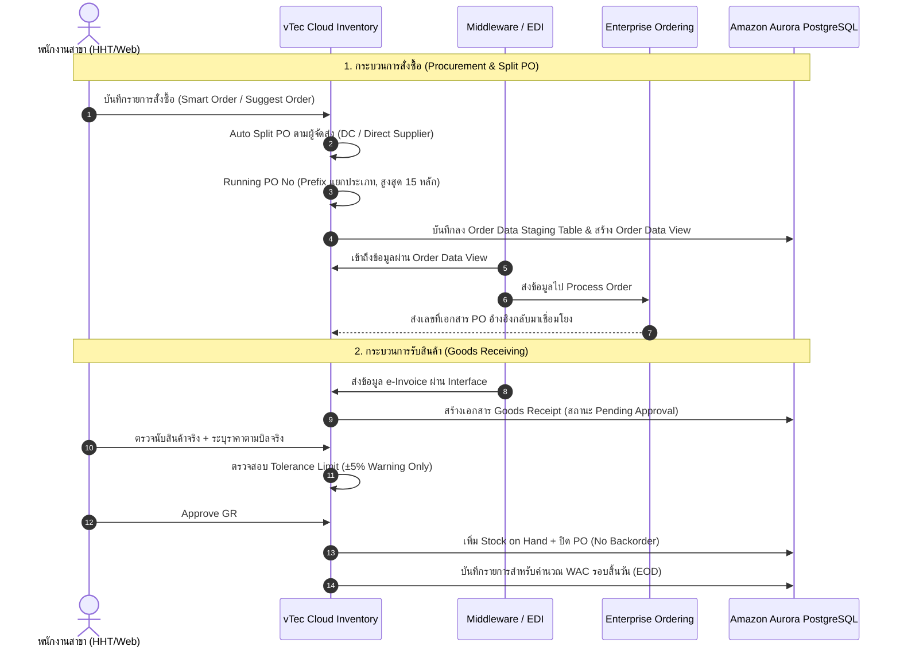
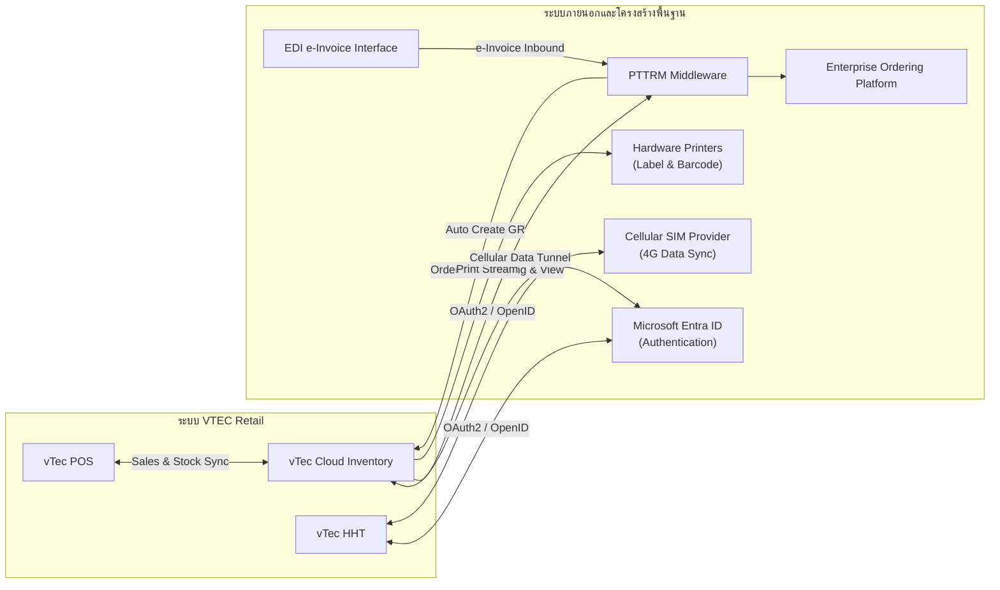

# Project Memory & Knowledge Base: ระบบ POS Vtec Retail
**ระบบ:** VTEC Retail Solution (vTec Cloud HQ, vTec Cloud Inventory, vTec POS, vTec HHT)  
**ขอบเขตงานเอกสาร:** BA06 - การปฏิบัติงานของสาขาในส่วนหลังร้าน และการจัดการสินค้า (Store Operation & Store Inventory)  
**เอกสารอ้างอิงหลัก:** `DSD_BA06_Store Back Operation & Inventory Management V2.0_20260910.docx` (DSD Version 2.0, วันที่ 10 กันยายน 2026)  
**ลูกค้า/หน่วยงาน:** PTTRM (PTT Retail Management Co., Ltd. - Jiffy Convenience Store & Retail)  
**สถานะเอกสาร:** Knowledge Base & Architectural Context สำหรับ Google Antigravity

---

## 1. Project Overview & Objective

### 1.1 วัตถุประสงค์หลักของระบบ (Main Objectives)
1. **ยกระดับและสร้างมาตรฐานการปฏิบัติงานหลังร้าน (Store Back Operation):** แปลงกระบวนการจัดการสินค้าหลังร้านของร้านสะดวกซื้อ Jiffy ให้เป็นระบบดิจิทัลที่ทำงานแบบกึ่งอัตโนมัติ ลดความผิดพลาดจากพนักงานหน้าร้าน
2. **บริหารจัดการสินค้าคงคลังอย่างแม่นยำ (Store Inventory Control):** ควบคุมการไหลของสต็อกสินค้าตั้งแต่ การสั่งซื้อ (Procurement), การรับเข้า (Receiving), การโอนย้าย (Transfer), การส่งคืนผู้จำหน่าย (Return to Vendor), การตรวจนับสต็อก (Stock Count) จนถึงการปรับปรุงยอด (Adjustment)
3. **คำนวณต้นทุนสินค้าคงคลังแบบ WAC (Weighted Average Costing) อัตโนมัติ:** บันทึกและคำนวณต้นทุนถัวเฉลี่ยถ่วงน้ำหนักทุกสิ้นวัน (EOD) อย่างถูกต้องตามหลักการบัญชีและภาษี
4. **รองรับการปฏิบัติงานแบบ Mobility & Offline บน HHT Device:** รองรับการทำงานของพนักงานสาขาและทีม Audit ผ่านอุปกรณ์ Handheld Terminal ที่ทำงานได้ทั้งแบบมีสัญญาณเครือข่ายและออฟไลน์
5. **ผสานรวมกับระบบสั่งซื้อส่วนกลาง (Enterprise Ordering & Middleware Integration):** จัดเตรียม Data Staging และ Data View เพื่อให้ระบบ Middleware และระบบ Ordering ภายนอกดึงข้อมูลไปประมวลผลต่อได้อย่างราบรื่น

---

### 1.2 ขอบเขตงาน (Scope of Work: 11 Business Processes / 43 Business Requirements)

| รหัสกระบวนการ | ชื่อกระบวนการธุรกิจ (Business Process) | จำนวนข้อกำหนด | FIT | GAP |
| :--- | :--- | :---: | :---: | :---: |
| **BR-06-01** | การสั่งซื้อสินค้า (Procurement & Suggest Order) | 5 | 2 | 3 |
| **BR-06-02** | Smart Order | 1 | 0 | 1 |
| **BR-06-03** | การสั่งซื้อและการอนุมัติ (Order Submission & Approval) | 5 | 2 | 3 |
| **BR-06-04** | การรับสินค้า (Receiving) | 6 | 2 | 4 |
| **BR-06-05** | การคืนสินค้าให้ผู้ขาย (Return To Vendor) | 5 | 1 | 4 |
| **BR-06-06** | การโอนสินค้า (Inventory Transfer) | 3 | 2 | 1 |
| **BR-06-07** | การตรวจนับและปรับสต็อก (Inventory Counting and Adjustment) | 5 | 3 | 2 |
| **BR-06-08** | การจัดการสินค้าหมดอายุ/เสียหาย (Expired/Damaged Management) | 3 | 1 | 2 |
| **BR-06-09** | การจัดการสินค้าฝากขาย (Consignment Management) | 4 | 4 | 0 |
| **BR-06-10** | การจัดการป้ายราคา (Price Tag and Label Management) | 3 | 1 | 2 |
| **BR-06-11** | การใช้งาน HHT / Mobile Device | 3 | 2 | 1 |
| **รวมทั้งสิ้น** | **11 หมวดงาน** | **43 BR** | **20** | **23** |

---

### 1.3 สิ่งที่ไม่รวมในขอบเขตงาน (Out of Scope)
1. **กระบวนการและ Business Logic ภายในของระบบภายนอก (Middleware & Ordering Logic):** วิธีการดึงข้อมูล, ความถี่การ polling, การจัดกลุ่ม (Grouping), การรวมยอด (Consolidation) และการสร้างใบ PO ฝั่งศูนย์กลาง เป็นความรับผิดชอบของระบบ Middleware/Ordering โดยระบบ vTec Cloud Inventory รับผิดชอบเฉพาะการเตรียม `Order Data Staging Table` และ `Order Data View`
2. **การแก้ไขข้อมูลหลักผู้ขายจากหน้าจอ PO:** การเปลี่ยนประเภทการชำระเงิน (Cash/Credit) บน PO มีผลเฉพาะเอกสารฉบับนั้น ไม่ปรับปรุงฐานข้อมูล Supplier Master
3. **การสร้างหรือแก้ไข Reason Code ณ สาขา:** พนักงานสาขาไม่มีสิทธิ์เพิ่ม แก้ไข หรือลบ Reason Code โดยข้อมูลทั้งหมดควบคุมจาก HQ เท่านั้น
4. **การแก้ไขจำนวนรับจริงจาก e-Invoice Interface:** หากรับสินค้าจากเอกสาร e-Invoice สาขาไม่สามารถแก้ไขจำนวนรับจริงในระบบ POS Vtec ได้ หากรับไม่ครบต้องทำรับตามใบส่งของแล้วเปิดใบคืนสินค้า (Return Inventory) ในภายหลัง
5. **การสร้าง Master ประเภท Vendor Consignment แยกต่างหาก:** การจำแนกคู่ค้าฝากขายใช้การผูกเงื่อนไขผ่าน `Vendor Group = Consign` ร่วมกับ `Product Department` ที่เป็น Consignment โดยตรง

---

### 1.4 ผู้ใช้งานและผู้มีส่วนได้ส่วนเสีย (Stakeholders & Roles)
1. **ผู้ดูแลระบบและฝ่ายปฏิบัติการสำนักงานใหญ่ (HQ Admin & Operation Team):**
   - จัดการข้อมูลหลัก (Master Data: Product, Supplier, Price Book, Reason Code)
   - กำหนดนโยบายและตารางตรวจนับสต็อก (Counting Policy: บังคับตรวจนับ 3 Department/เดือน)
   - ตรวจสอบแดชบอร์ดการสั่งซื้อรวมทุกสาขา (HQ Order Monitoring Dashboard)
   - ตรวจสอบรายงานกระทบยอดการโอนสินค้าข้ามสาขา (Transfer Reconciliation)
2. **ผู้จัดการสาขา Jiffy (Store Manager / Authorized Role):**
   - อนุมัติเอกสารใบสั่งซื้อ (PO Approval)
   - อนุมัติเอกสารรับสินค้า (Goods Receipt Approval)
   - อนุมัติเอกสารใบคืนสินค้า (Return Note Approval)
   - อนุมัติเอกสารโอนสินค้าออกและรับโอนเข้า (Transfer Out / Transfer In Approval)
   - อนุมัติเอกสารปรับปรุงสต็อก (Stock Adjustment Approval โดยตรวจสอบจากมูลค่าต้นทุนรวม)
   - อนุมัติการใช้สติกเกอร์ลดราคาป้ายเหลืองหน้าร้าน
3. **พนักงานสาขา Jiffy / แคชเชียร์ (Store Staff / Cashier):**
   - สร้างเอกสารใบสั่งซื้อปกติ และสร้างใบสั่งซื้อผ่าน Smart Order / Suggest Order
   - ตรวจรับสินค้า ณ สาขา (Goods Receipt via PO / e-Invoice / Manual Receiving)
   - ตรวจนับสต็อกสินค้าตามรอบ (Store Count) ผ่านอุปกรณ์ HHT แบบ Blind Count
   - ดำเนินการสแกนคิดเงินสินค้าลดราคาป้ายเหลืองผ่านเครื่อง vTec POS
   - พิมพ์ป้ายราคาปกติ ป้ายโปรโมชั่น และสั่งพิมพ์จากคิว HQ
4. **ทีมตรวจสอบสต็อก (Audit Team):**
   - ดำเนินการตรวจนับสต็อกประจำงวด (Audit Count) ผ่านอุปกรณ์ HHT แบบ Blind Count
   - ตรวจสอบผลต่างสต็อก (Variance) และมูลค่าผลต่างจาก Beginning WAC เพื่อขออนุมัติปรับยอดสต็อก
5. **ผู้จัดจำหน่ายและศูนย์กระจายสินค้า (Suppliers & DC):**
   - ศูนย์กระจายสินค้า (Distribution Center - DC) และผู้จัดส่งโดยตรง (Direct Supplier)
   - ส่งข้อมูลใบแจ้งหนี้อิเล็กทรอนิกส์ (e-Invoice) ผ่าน Middleware Interface
6. **ทีมพัฒนาระบบ Middleware & PTTRM IT:**
   - ดูแลการเชื่อมต่อ API, IPSec VPN Gateway, Interface ข้อมูลระหว่าง vTec Cloud และระบบ SAP/ERP ขององค์กร

---

## 2. Architecture & Technical Specifications

### 2.1 Tech Stack, แพลตฟอร์ม และฮาร์ดแวร์

```mermaid
flowchart TD
    subgraph Cloud["AWS Cloud Environment (Central AWS VPC)"]
        Aurora[("Amazon Aurora PostgreSQL<br/>- Master Data Tables<br/>- Transaction Tables<br/>- Staging & Data Views")]
        Entra["Microsoft Entra ID<br/>(SSO / IAM Central Authentication)"]
        HQ["vTec Cloud HQ<br/>(Master & Policy Management)"]
        Inv["vTec Cloud Inventory<br/>(Store Backoffice & Stock Engine)"]
    end

    subgraph Branch["Jiffy Store Environment (สาขา)"]
        POS["vTec POS (Windows)<br/>Local DB Cache<br/>Username / Password / Fingerprint"]
        HHT["vTec HHT (Android Mobile App)<br/>Local SQLite DB<br/>Hardware Barcode Scanner"]
        LabelPrinter["Store Label / Thermal Printer<br/>(พิมพ์ป้ายราคาปกติ & โปรโมชั่น)"]
        BranchRouter["Branch Network Router<br/>(LAN / Wi-Fi / 4G SIM)"]
    end

    subgraph External["External Systems (ระบบภายนอก)"]
        Middleware["PTTRM Enterprise Middleware"]
        OrderingSystem["Enterprise Ordering System / EDI"]
        SupplierDC["DC & Direct Suppliers (e-Invoice)"]
    end

    HQ <--> Aurora
    Inv <--> Aurora
    HQ & Inv -.->|SSO Authentication| Entra
    HHT -.->|Login Auth| Entra

    POS <-->|REST API / HTTPS| Aurora
    HHT <-->|REST API (Online/Offline Sync)| Inv
    Inv --> LabelPrinter

    SupplierDC -->|e-Invoice| Middleware
    Middleware -->|REST API Interface| Inv
    Inv -->|Order Data Staging & Data View| Middleware
    Middleware --> OrderingSystem
```

1. **vTec Cloud HQ (Web Application):**
   - **Deployment:** AWS Cloud (Multi-AZ Deployment)
   - **Database:** Amazon Aurora PostgreSQL
   - **Authentication:** Microsoft Entra ID (Single Sign-On ด้วยบัญชีองค์กร)
   - **Scope:** จัดการ Master Data, Price Book, Reason Code, Counting Policy, Dashboard ภาพรวม
2. **vTec Cloud Inventory (Web Application - Store Backoffice):**
   - **Deployment:** AWS Cloud
   - **Database:** Amazon Aurora PostgreSQL
   - **Authentication:** Microsoft Entra ID (รองรับการเลือก Company / Brand / Branch ตามสิทธิ์)
   - **Scope:** บริหารงานคลังสินค้าสาขา, PO, GR, Return, Transfer, Count, Adjustment, Consignment, WAC Engine
   - **Device Agnostic:** เข้าใช้งานผ่าน Web Browser มาตรฐานได้จากทุกอุปกรณ์ (รองรับกรณีเครื่องสาขาชำรุด)
3. **vTec POS (Windows Application):**
   - **Deployment:** On-Premise เครื่องแคชเชียร์ประจำสาขา Jiffy
   - **Local Database:** ฐานข้อมูล Local Cache ประจำเครื่อง
   - **Central Database:** Amazon Aurora PostgreSQL ผ่าน REST API ปลอดภัย
   - **Authentication:** VTEC Local Authentication (รองรับ Username/Password และ Fingerprint)
   - **Operating Mode:** รองรับทั้ง Online และ Offline Mode พร้อม Near Real-Time Synchronization
4. **vTec HHT (Native Android Mobile Application):**
   - **Deployment:** อุปกรณ์พกพา Handheld Terminal (Android OS)
   - **Hardware Specs:** รองรับหัวอ่านสแกนเนอร์บาร์โค้ดในตัว (Hardware Scan Engine) และช่องใส่ Cellular SIM Card
   - **Local Database:** SQLite ภายในอุปกรณ์ HHT
   - **Authentication:** Microsoft Entra ID (ต้องเชื่อมต่อเครือข่ายตอน Login ครั้งแรก หลังจากนั้นใช้งาน Offline ได้จนกว่าจะ Logout หรือ Session หมดอายุ)
   - **Network Redundancy:** จัดลำดับความสำคัญของเครือข่ายอัตโนมัติ: `Wi-Fi (Priority 1)` -> `4G SIM (Priority 2)` -> `Offline Mode (Priority 3)`

---

### 2.2 โครงสร้างระบบและ Data Flow หลัก



---

### 2.3 Data Schema, Entity & Data Model สำคัญ

#### 1) Order Data View Schema (สำหรับ Middleware & Ordering)
ตาราง Staging และ View กลางสำหรับเปิดให้ระบบสั่งซื้อภายนอกดึงข้อมูล:

| ชื่อฟิลด์ (Field Name) | ชนิดข้อมูล (Data Type) | คำอธิบาย (Description) | ข้อกำหนด/เงื่อนไข |
| :--- | :--- | :--- | :--- |
| `Branch_Code` | `VARCHAR(20)` | รหัสสาขา Jiffy | อ้างอิง Master สาขา |
| `Supplier_Code` | `VARCHAR(20)` | รหัสคู่ค้า/ผู้จัดจำหน่าย | อ้างอิง Supplier Master |
| `Supplier_Name` | `VARCHAR(150)` | ชื่อคู่ค้า/ผู้จัดจำหน่าย | แสดงผล |
| `Product_Code` | `VARCHAR(30)` | รหัสสินค้า | รหัสสินค้าของระบบ VTEC |
| `Barcode` | `VARCHAR(30)` | บาร์โค้ดสินค้าที่สั่งซื้อ | บาร์โค้ดหลักของบรรจุภัณฑ์ที่สั่ง |
| `Product_Name` | `VARCHAR(200)` | ชื่อสินค้า | ชื่อทางการค้า |
| `Order_Qty` | `INTEGER` | จำนวนสั่งซื้อ | จำนวนเต็มบวก > 0 |
| `Pack_Size` | `INTEGER` | ขนาดบรรจุในการสั่งซื้อ | อ้างอิงตาม UOM ที่เลือก |
| `Order_UOM_Name` | `VARCHAR(50)` | ชื่อหน่วยสั่งซื้อ | เช่น ลัง, แพ็ค, ห่อ, ชิ้น |
| `Unit_Price_Per_Pack` | `DECIMAL(12,4)` | ราคาสินค้าต่อหน่วยสั่งซื้อ | ดึงจาก Price Book วันที่ออกเอกสาร |
| `Amount` | `DECIMAL(14,2)` | มูลค่ารวมของรายการ | `Order_Qty * Unit_Price_Per_Pack` |
| `Reference_Order_Doc` | `VARCHAR(50)` | เลขที่เอกสารอ้างอิงของสาขา | เลขที่ใบสั่งซื้อที่สร้างขึ้นใน VTEC |
| `Order_DateTime` | `TIMESTAMP` | วันที่และเวลาที่กดยืนยันคำสั่งซื้อ | บันทึกเวลาทำรายการของสาขา |
| `PO_No` | `VARCHAR(15)` | เลขที่ PO จาก Ordering ภายนอก | **ความยาวสูงสุดไม่เกิน 15 หลัก (EDI Constraint)** |

#### 2) Goods Receipt (GR) Model
- `GR_No`: เลขที่เอกสารรับสินค้า (Running Number)
- `Supplier_Code`: รหัสผู้จำหน่าย
- `PO_No`: เลขที่ใบสั่งซื้ออ้างอิง
- `eInvoice_No`: เลขที่ e-Invoice (กรณีรับจาก Interface)
- `Delivery_Note_No`: เลขที่ใบส่งของ / ใบกำกับภาษีของผู้จำหน่าย
- `Doc_Date` / `Received_Date`: วันที่เอกสาร / วันที่รับเข้าจริง
- `Item_Details`:
  - `Product_Code`, `Barcode`, `Order_UOM`
  - `PO_Qty`: จำนวนตาม PO
  - `Received_Qty`: จำนวนรับเข้าจริง (**ห้ามแก้กรณีรับจาก e-Invoice**)
  - `Unit_Cost_PO`: ต้นทุนต่อหน่วยตาม PO
  - `Unit_Cost_Invoice`: ต้นทุนต่อหน่วยตามใบแจ้งหนี้จริง (หากแก้ไขจะแสดงตัวอักษรสีต่างจากเดิม)
  - `Price_Variance`: ผลต่างราคา (`Unit_Cost_Invoice - Unit_Cost_PO`)
  - `Price_Discrepancy_Reason`: เหตุผลผลต่างราคา
  - `VAT_Rate`: อัตราภาษีมูลค่าเพิ่ม (%)
  - `Receiving_Tax`: ยอดรวมภาษีทั้งบิล
  - `Total_Amount`: ยอดสุทธิทั้งบิล (`Net + Tax`)
- `Tolerance_Validation`:
  - `Variance_Qty` = `Received_Qty - PO_Qty`
  - `Variance_Pct` = `(Variance_Qty / PO_Qty) * 100`
  - `Tolerance_Limit` = `±5%` (เกณฑ์เตือน Warning Only ไม่บล็อกการบันทึก)
- `Status`: `Pending Receiving / Pending Approval` -> `Approved / Received` / `Cancelled`

#### 3) Daily WAC Ledger / Cost History Model
- `Business_Date`: วันที่ของรอบบัญชี
- `Branch_Code`: รหัสสาขา
- `SKU`: รหัสสินค้า
- `BOD_WAC`: ต้นทุนเฉลี่ยต้นวัน (Beginning of Day WAC)
- `Opening_Qty`: จำนวนสต็อกต้นวัน
- `Opening_Value`: มูลค่าสต็อกต้นวัน (`Opening_Qty * BOD_WAC`)
- `Total_Receiving_Qty`: จำนวนรับเข้าระหว่างวันรวม (Supplier GR + Transfer In)
- `Total_Receiving_Value`: มูลค่ารับเข้าระหว่างวันรวม
- `EOD_WAC`: ต้นทุนเฉลี่ยสิ้นวัน (End of Day WAC)
- `Calculation_Timestamp`: เวลาที่ประมวลผล Batch EOD

#### 4) Stock Movement / Audit Trail Model
- บันทึกการเคลื่อนไหวสต็อกทุกประเภท: Sales, GR, Return, Transfer Out, Transfer In, Adjustment In, Adjustment Out
- ฟิลด์บันทึก: `Movement_ID`, `Doc_No`, `Doc_Type`, `Branch_Code`, `SKU`, `Qty`, `Cost_Source`, `Unit_Cost`, `Total_Cost`, `User_ID`, `Created_Timestamp`

---

## 3. Business Logic & Operational Rules

### 3.1 กฎเกณฑ์ทางธุรกิจที่ห้ามละเมิด (Inviolable Business Rules)

1. **ข้อจำกัดความยาวเลขที่ PO (EDI 15-Digit Constraint):**
   - การ Running เลขที่เอกสาร PO ทั้งหมดในระบบ VTEC จะต้องมี**ความยาวสูงสุดไม่เกิน 15 หลัก (digits)**
   - สาเหตุ: ระบบส่งต่อข้อมูลไปยัง EDI รองรับความยาวฟิลด์ PO No. ได้สูงสุดเพียง 15 หลักเท่านั้น
   - รูปแบบโครงสร้างรหัส: รหัสสาขา (5 หลัก) + PO + เดือนปี (4 หลัก) + Running No. (4 หลัก) เช่น `34008PO08260001` (DC), `34008PO08260002` (Direct Supplier)
2. **การล็อกเอกสาร PO หลังการอนุมัติ (Status Locking):**
   - เมื่อเอกสาร PO ได้รับการอนุมัติ (Approved) ระบบต้องล็อกหน้าจอเป็น **Read-only ทันที**
   - ปุ่ม `Save`, `Edit`, `Delete`, `Approve` ต้องถูกปิดการทำงาน (Disabled) ไม่อนุญาตให้แก้ไขข้อมูลย้อนหลัง
3. **การ Re-submit / ยกเลิก PO (Cancel & Re-submit PO):**
   - ยกเลิกได้เฉพาะก่อนที่ PO จะถูกนำไปอ้างอิงทำ GR และก่อนที่สาขาจะปิดรอบประจำวัน (Daily EOD)
   - กระบวนการสร้างใบใหม่ต้องผ่าน Audit Trail ที่ตรวจสอบได้:
     $$\text{Approved PO \#001} \xrightarrow{\text{Cancel}} \text{Cancelled} \xrightarrow{\text{Copy}} \text{สร้าง PO \#002} \xrightarrow{\text{แก้ไขจำนวน}} \text{Submit / Approve PO \#002}$$
4. **เกณฑ์ผ่อนผันการรับสินค้า (Receiving Tolerance Limit):**
   - กำหนดค่าเกณฑ์ผ่อนผันที่ระดับ Brand โดยมีค่าเริ่มต้นมาตรฐานคือ **$\pm 5\%$**
   - Tolerance เป็นเพียง **"Warning Threshold" ไม่ใช่ "Blocking Threshold"**
   - หากรับขาดหรือเกินกว่า 5% ระบบจะแสดง Popup Warning ระบุจำนวนและ % ผลต่างอย่างชัดเจน แต่**ยังคงอนุญาตให้ผู้ใช้กดยืนยันบันทึก GR ได้โดยไม่ต้องใช้ Manager Override**
5. **ความคงที่ของจำนวนรับสินค้าจาก e-Invoice (e-Invoice Immutability):**
   - เมื่อระบบสร้าง GR จาก e-Invoice ผ่าน Interface **สาขาจะไม่สามารถแก้ไขฟิลด์จำนวนรับจริง (Received Qty) ในระบบ POS Vtec ได้**
   - หากสินค้ามาส่งไม่ครบตาม e-Invoice สาขาต้องตรวจรับเข้าตามบิลก่อน แล้วจึงสร้างเอกสารใบคืนสินค้า (Return Inventory) สำหรับสินค้าส่วนที่ขาด/ชำรุดในภายหลัง
6. **การปิด PO แบบไม่มี Backorder (No Partial Outstanding PO):**
   - หากรับสินค้าจริงไม่ครบตามจำนวนใน PO เมื่อกดอนุมัติ GR ระบบจะปิดสถานะ PO เป็น **`Closed / Completed` ทันที**
   - ระบบจะ**ไม่มีการเปิดยอดค้างรับ (No Backorder)** สำหรับการรับสินค้าครั้งต่อไปใน PO เดิม
7. **ตรรกะการคำนวณต้นทุน WAC (Weighted Average Costing Logic):**
   - **สูตรคำนวณ WAC สิ้นวัน (EOD WAC):**
     $$\text{WAC}_{\text{EOD}} = \frac{(\text{Opening Qty} \times \text{Opening WAC}) + \sum (\text{Receiving Qty} \times \text{Receiving Cost})}{\text{Opening Qty} + \sum \text{Receiving Qty}}$$
   - **การนำ WAC ไปใช้กับธุรกรรม:**
     - **Sales Transaction (รายการขายหน้าร้าน POS):** ใช้ **$\text{WAC}_{\text{EOD}}$ (WAC สิ้นวัน)** ของวันนั้น เพื่อคำนวณ COGS และ Gross Profit ประจำวัน
     - **Non-Sales Transaction (โอนย้าย, เบิกใช้, ส่งคืน Supplier, ปรับปรุงสต็อก):** ใช้ **$\text{WAC}_{\text{BOD}}$ (WAC ต้นวัน)** ของวันที่ทำรายการ
   - **การส่งต่อข้ามวัน:** $\text{WAC}_{\text{BOD}}(D+1) = \text{WAC}_{\text{EOD}}(D)$
   - **กรณีไม่มีรับสินค้าระหว่างวัน:** $\text{WAC}_{\text{EOD}} = \text{WAC}_{\text{BOD}}$
   - **กรณีสินค้าใหม่ (ไม่มีสต็อกต้นวัน):** $\text{WAC}_{\text{EOD}} = \frac{\text{มูลค่ารับเข้ารวม}}{\text{จำนวนรับเข้ารวม}}$
   - **การรับสินค้าต้นทุนศูนย์ (Zero Cost Stock Receiving เช่น สินค้าแถม/พรีเมียม):** บันทึกรับจำนวนเข้า Stock On Hand ได้จริง แต่**ยกเว้นไม่นำมูลค่า 0 บาทเข้าสูตรคำนวณ WAC** เพื่อไม่ให้ต้นทุนเฉลี่ยเดิมของสินค้าถูกเจือจาง (Dilute)
8. **ลำดับการเลือกต้นทุนสำหรับสินค้าส่งคืน (Return Costing Priority):**
   - **ลำดับที่ 1:** มีเอกสารรับสินค้าอ้างอิง และพบเอกสารในระบบ $\rightarrow$ ใช้ **ต้นทุนต่อหน่วยจากเอกสาร GR อ้างอิง**
   - **ลำดับที่ 2:** ไม่มีเอกสารรับสินค้าอ้างอิง $\rightarrow$ ใช้ **$\text{WAC}_{\text{BOD}}$ (WAC ต้นวัน)**
   - **ลำดับที่ 3:** ระบุเอกสารอ้างอิง แต่ระบบค้นหาไม่พบ $\rightarrow$ ใช้ **$\text{WAC}_{\text{BOD}}$** และบันทึก `Cost Source = Beginning of Day WAC` ใน Audit Trail
9. **การตัดสต็อกใบคืนสินค้า (Return to Vendor Stock Cut):**
   - การกด `Approve` ใบคืนสินค้า เป็นเพียงการอนุมัติเอกสารทางธุรการ **ยังไม่มีการตัดสต็อก**
   - สต็อกจะถูกตัดลดลง (Stock Cut) ก็ต่อเมื่อพนักงานกดปุ่ม **`Confirm Return / Complete Return` ในขั้นตอนส่งมอบสินค้าให้ผู้จำหน่ายจริงเท่านั้น**
   - การยกเลิกใบคืนสินค้าทำได้เฉพาะก่อนการประมวลผล EOD ของสาขา
10. **การจัดการต้นทุนการโอนย้ายสินค้าข้ามสาขา (Transfer Costing):**
    - **สาขาต้นทาง (Transfer Out):** ตัดต้นทุนออกจากคลังโดยใช้ **$\text{WAC}_{\text{BOD}}$ ของสาขาต้นทาง**
    - **สาขาปลายทาง (Transfer In):** ต้องรับเข้าโดยใช้ **ต้นทุนต่อหน่วยเดียวกันกับ Transfer Out จากสาขาต้นทาง** ห้ามใช้ WAC ของสาขาปลายทางมาแทนที่
    - สาขาปลายทางจะนำรายการรับโอนนี้ไปรวมคำนวณในสูตร WAC สิ้นวันของตนเองเหมือนรายการรับเข้าประจำวัน
11. **การแยกประเภทการตรวจนับสต็อก (Store Count vs Audit Count):**
    - **Store Count:** การนับประจำวัน/รอบปกติของสาขา $\rightarrow$ คำนวณผลต่าง (Variance) และเก็บบันทึกประวัติ **แต่ไม่ปรับปรุงยอด Stock On Hand ในระบบ**
    - **Audit Count:** การนับรอบพิเศษ/ตรวจการณ์ของทีม Audit $\rightarrow$ คำนวณผลต่าง $\rightarrow$ ประเมินมูลค่าผลต่างด้วย $\text{WAC}_{\text{BOD}}$ $\rightarrow$ เมื่อได้รับอนุมัติ **ระบบจะปรับปรุง Stock On Hand ให้ตรงกับยอดที่นับได้จริง**
12. **การตรวจนับแบบ Blind Count บน HHT:**
    - ขณะพนักงานหรือผู้ตรวจสอบกำลังทำการสแกนนับสินค้าบนหน้าจอ HHT **ระบบต้องไม่แสดงจำนวนสต็อกคงเหลือในระบบ (System Qty / On-hand)** ให้เห็นโดยเด็ดขาด เพื่อป้องกันความเอนเอียงในการนับ
13. **นโยบายการตรวจนับบังคับจากส่วนกลาง (HQ Mandatory Counting Policy):**
    - สำนักงานใหญ่ (HQ) มีอำนาจกำหนด Counting Policy ส่งไปยังสาขา
    - กำหนดให้สาขาต้องตรวจนับสินค้าบังคับ (Mandatory Count) อย่างน้อย **3 Department ต่อเดือน** หากเกินกำหนดระบบจะตั้งสถานะเป็น `Overdue`
14. **การควบคุมการปรับปรุงสต็อก (Stock Adjustment Control):**
    - **UI Separation:** แยกหน้าจอและสิทธิ์ระหว่าง "ปรับเพิ่มสต็อก (Stock Adjustment In)" และ "ปรับลดสต็อก (Stock Adjustment Out)" ออกจากกันอย่างเด็ดขาด
    - **HQ Reason Code Control:** รหัสเหตุผล (Reason Code) ทุกตัวต้องถูกสร้างและควบคุมจาก HQ สาขาทำได้เพียงเลือกใช้ ห้ามพิมพ์เพิ่มหรือแก้ไขเอง
    - **Total Cost Approval Blocker:** หน้าจอขออนุมัติปรับปรุงสต็อกต้องแสดงผลรวมมูลค่าต้นทุน (คำนวณจาก WAC) หากระบบไม่สามารถดึง WAC หรือไม่สามารถคำนวณมูลค่ารวมได้ **ปุ่ม Approve จะถูกปิดการใช้งาน (Disabled) ทันที**
15. **สูตรการสั่งซื้อตามปริมาณแนะนำอัตโนมัติ (Suggest Order - SGO Formula):**
    - $\text{SGO Base} = (\text{Forecast Daily Sale} \times \text{Lead Time}) + \text{Safety Stock} - \text{Current On-Hand Stock} - \text{Incoming Stock}$
    - $\text{Suggest Order (SGO)} = \text{SGO Base} \times \text{New Product Factor} \times \text{Promotion Factor} \times \text{Seasonal Factor} \times \text{Planogram Factor}$
    - เกณฑ์การใช้งาน: หากคำนวณแล้วค่าน้อยกว่าหรือเท่ากับ 0 ระบบจะแนะนำที่ 0
    - หากพนักงานสาขาแก้ไขตัวเลขจากค่าที่ระบบแนะนำ ระบบจะ**บังคับให้ระบุเหตุผลการปรับเปลี่ยนจำนวน**ทุกรายการ หากไม่ระบุจะไม่ยอมให้บันทึก

---

### 3.2 ขั้นตอนการทำงานแบบ Step-by-Step (Standard Operating Procedures)

#### SOP-01: การสั่งซื้อสินค้าและแยกใบสั่งซื้ออัตโนมัติ (Smart Order / Auto Split PO)
1. เข้าสู่ระบบ vTec Cloud Inventory หรือเปิดแอปพลิเคชัน vTec HHT
2. กรณีใช้ HHT: ดาวน์โหลด Master Data ล่าสุดลงเครื่อง $\rightarrow$ สแกนบาร์โค้ดสินค้า $\rightarrow$ ระบุจำนวนสั่งซื้อตาม Pack Size $\rightarrow$ กดยืนยันเพื่อ Sync ข้อมูลเข้า vTec Cloud Inventory
3. กรณีใช้ vTec Cloud Inventory: เมนูการจัดการคลังสินค้า/จัดซื้อ $\rightarrow$ สร้างเอกสารใบสั่งซื้อ $\rightarrow$ เลือกรหัสผู้ขาย หรือเลือกฟังก์ชัน Smart Order $\rightarrow$ เลือกรายการสินค้าและระบุ UOM พร้อมจำนวนสั่งซื้อ
4. ระบบประมวลผลแยกกลุ่มรายการสินค้าตามประเภทผู้จัดส่งอัตโนมัติ:
   - กลุ่มศูนย์กระจายสินค้า (Distribution Center - DC)
   - กลุ่มผู้จัดส่งโดยตรง (Direct Supplier) แยกตามผู้จำหน่ายแต่ละราย
5. ระบบสร้างเอกสารใบสั่งซื้อแยกฉบับพร้อม Running เลขที่ PO อัตโนมัติ (ความยาวไม่เกิน 15 หลัก) เช่น `34008PO08260001` (DC), `34008PO08260002` (Direct Supplier)
6. ระบบแสดง Popup สรุปผลรายการใบสั่งซื้อทั้งหมดที่ถูกสร้างขึ้นในรอบนั้น เพื่อให้เปิดตรวจสอบรายละเอียดหรือสั่งพิมพ์เอกสารได้ทันที
7. ผู้จัดการสาขาตรวจสอบความถูกต้องและกดอนุมัติ (Approve PO) เพื่อล็อกเอกสารเป็น Read-only
8. ระบบส่งข้อมูลเข้า `Order Data Staging Table` และเปิด `Order Data View` เพื่อให้ Middleware ดึงข้อมูลไป Process Order ต่อไป

#### SOP-02: การรับสินค้าอ้างอิง PO / e-Invoice และ Manual Receiving
1. เข้าสู่ระบบ vTec Cloud Inventory $\rightarrow$ เมนูการจัดการคลังสินค้า/จัดซื้อ $\rightarrow$ เอกสารการรับสินค้า (Goods Receipt)
2. **กรณีรับจาก e-Invoice Interface:**
   - ระบบภายนอกส่ง e-Invoice เข้ามา ระบบสร้าง GR ให้อัตโนมัติในสถานะ `Pending Approval`
   - เมื่อสินค้ามาถึง พนักงานเปิดเอกสาร GR เพื่อตรวจนับสินค้าจริงเทียบกับบิล
   - พนักงาน**ไม่สามารถแก้ไขจำนวนรับจริงในระบบได้** (ตามกฎข้อ 3.1.5)
   - พนักงานสามารถปรับปรุงราคาทุนตามบิลจริงได้ (ระบบจะแสดงตัวอักษรสีแตกต่างเพื่อแจ้งเตือนว่ามีการแก้ไข)
3. **กรณีรับอ้างอิง PO หรือรับแบบไม่มี PO (Manual Receiving):**
   - เลือกสร้างเอกสารรับสินค้า $\rightarrow$ เลือกรหัสผู้จำหน่ายและระบุเลขที่ใบส่งของ/Invoice
   - สแกนหรือค้นหารายการสินค้า ตรวจสอบความสัมพันธ์กับผู้จำหน่าย
   - ระบุจำนวนรับเข้าจริง (Received Qty) และราคาทุนต่อหน่วย
4. ระบบคำนวณผลต่างและตรวจสอบกับเกณฑ์ Tolerance Limit ($\pm 5\%$):
   - หากผลต่างเกิน 5% ระบบแสดง Popup Warning แจ้งเตือน แต่ไม่อายัดเอกสาร
5. ผู้มีอำนาจกดปุ่ม **บันทึกและอนุมัติการรับสินค้า (Approve GR)**
6. ระบบปรับเพิ่มจำนวนสินค้าเข้า Stock On Hand ทันที
7. ระบบปรับสถานะ GR เป็น `Approved/Completed` และปรับสถานะ PO เป็น `Closed` โดยไม่เปิด Backorder
8. ระบบบันทึกจำนวนรับและราคาทุนจริงเข้าฐานข้อมูลเพื่อรอประมวลผล WAC ในรอบสิ้นวัน (EOD)

#### SOP-03: การส่งคืนสินค้าให้ผู้จำหน่าย (Return to Vendor)
1. เข้าสู่ระบบ vTec Cloud Inventory $\rightarrow$ เมนูการจัดการคลังสินค้า/จัดซื้อ $\rightarrow$ เอกสารใบคืนสินค้า (Return Note)
2. กดสร้างเอกสารใหม่ เลือกรหัสผู้จำหน่าย และระบุเลขที่เอกสารอ้างอิง (Invoice No. / GR No. ถ้ามี)
3. เลือกรายการสินค้าที่ต้องการคืน และระบุจำนวนคืน (Return Qty)
4. เลือกรหัสเหตุผลการคืนสินค้า (**บังคับระบุ 1 ใน 5 Reason Codes**: `Damaged`, `Expired`, `Wrong Item`, `Overstock`, `Quality Issue`)
5. ระบบกำหนดต้นทุนการคืนตาม Costing Priority (ดึงจาก GR อ้างอิง $\rightarrow$ หากไม่มีให้ใช้ $\text{WAC}_{\text{BOD}}$)
6. ตรวจสอบข้อมูลและกดปุ่ม **Submit for Approval** (สถานะเปลี่ยนเป็น `Pending Approval` พร้อมส่ง Email แจ้งเตือนผู้จัดการ)
7. ผู้จัดการสาขาตรวจสอบเอกสารและกดปุ่ม **Approve** (สถานะเปลี่ยนเป็น `Approved` **โดยในขั้นตอนนี้ยังไม่ตัดสต็อก**)
8. เมื่อผู้จำหน่ายมารับสินค้า พนักงานตรวจสอบของจริงและกดปุ่ม **Complete Return / Confirm Return**
9. ระบบตัดลด Stock On Hand จริง บันทึก Inventory Movement และเปลี่ยนสถานะเอกสารเป็น `Completed / Returned`

#### SOP-04: การโอนย้ายสินค้าระหว่างสาขา (Inventory Transfer Out & Transfer In)
1. **สาขาต้นทาง (Transfer Out):**
   - เข้าสู่ระบบ $\rightarrow$ สร้างเอกสาร Transfer Out ระบุสาขาปลายทางและรายการสินค้าพร้อมจำนวน
   - ระบบดึง $\text{WAC}_{\text{BOD}}$ ของสาขาต้นทางมาเป็นต้นทุนต่อหน่วยในการโอน
   - ผู้จัดการสาขาต้นทางกดอนุมัติ (Approve)
   - ระบบตัดสต็อกสาขาต้นทางทันที และสร้าง Transfer Reference No. ส่งข้อมูลไปยังระบบกลาง
2. **สาขาปลายทาง (Transfer In):**
   - เข้าสู่ระบบ $\rightarrow$ ค้นหาเอกสารรับโอนจาก Transfer Reference No.
   - ตรวจนับสินค้าจริง ระบุจำนวนรับ และระบบจะใช้ต้นทุนต่อหน่วยเดียวกันกับสาขาต้นทาง
   - ผู้จัดการสาขาปลายทางกดอนุมัติ (Approve)
   - ระบบเพิ่มสต็อกสาขาปลายทาง และนำรายการไปรวมคำนวณ WAC สิ้นวัน
3. **ส่วนกลาง (HQ Reconciliation):**
   - ระบบส่วนกลางเปรียบเทียบ Transfer Out vs Transfer In ตาม Transfer Reference No.
   - จัดกลุ่มสถานะกระทบยอดเป็น `Matched`, `Partial`, `Not Received`, หรือ `Over Received` เพื่อการติดตาม

#### SOP-05: การตรวจนับสต็อกแบบ Blind Count และการแจ้งเตือนจากส่วนกลาง
1. สำนักงานใหญ่ (HQ) สร้าง Counting Schedule ใน vTec Cloud HQ กำหนด Department และระบุ Mandatory Count 3 หมวด/เดือน
2. ระบบ vTec Cloud Inventory ส่ง Notification แจ้งเตือนสาขาเมื่อถึงกำหนดตรวจนับ
3. พนักงานสาขาหรือทีม Audit เปิดแอปพลิเคชัน vTec HHT รับ Checklist งานตรวจนับ
4. ทำการสแกนบาร์โค้ดสินค้านับจำนวนจริง (**ระบบ HHT ซ่อน System On-Hand Qty ตามหลัก Blind Count**)
5. ส่งผลการนับเข้าสู่ระบบ vTec Cloud Inventory
6. ระบบคำนวณผลต่างสต็อก (Variance Qty) และประเมินมูลค่าด้วย $\text{WAC}_{\text{BOD}}$:
   - **กรณี Store Count:** บันทึกประวัติผลการนับ จบกระบวนการ **โดยไม่ปรับสต็อก**
   - **กรณี Audit Count:** ส่งขออนุมัติ $\rightarrow$ เมื่อผู้มีอำนาจกด Approve ระบบจะปรับปรุงยอด Stock On Hand ให้ตรงกับยอดนับจริง
7. สำนักงานใหญ่เรียกดู Counting Monitoring Dashboard เพื่อติดตามสาขาที่ยังไม่เริ่มนับ กำลังนับ หรือสถานะ `Overdue`

#### SOP-06: การปรับปรุงสต็อกสินค้าชำรุด/หมดอายุ (Stock Adjustment)
1. พนักงานสาขาเข้าสู่ระบบ vTec Cloud Inventory $\rightarrow$ เมนูการจัดการคลังสินค้า/จัดซื้อ
2. เลือกหน้าจอตามวัตถุประสงค์อย่างชัดเจน:
   - คลิกเมนู **"ปรับเพิ่มสต็อก (Stock Adjustment In)"** หรือ
   - คลิกเมนู **"ปรับลดสต็อก (Stock Adjustment Out)"**
3. เลือกรายการสินค้า ระบุจำนวนที่ต้องการปรับปรุง
4. เลือกรหัสเหตุผล (Reason Code) จาก Dropdown List ซึ่งดึง Master มาจาก HQ เท่านั้น
5. ระบบคำนวณมูลค่าต้นทุนรวมอัตโนมัติจาก $\text{WAC} \times \text{จำนวนปรับปรุง}$ และแสดงผลสรุปยอดเงินทั้งเอกสาร
6. กดส่งเอกสารขออนุมัติ (Submit for Approval)
7. ผู้จัดการสาขาเปิดเอกสาร ตรวจสอบรายละเอียดและ**วิเคราะห์มูลค่าต้นทุนรวมทั้งเอกสาร**
8. หากระบบแสดงมูลค่าเงินรวมถูกต้อง ผู้จัดการกดปุ่ม **อนุมัติ (Approve)** เพื่อปรับยอดสต็อก
   *(หากระบบไม่สามารถคำนวณมูลค่าเงินรวมได้ ปุ่ม Approve จะถูกปิดการทำงาน)*

#### SOP-07: การจัดการป้ายราคาปกติ ป้ายโปรโมชั่น และสติกเกอร์ลดราคาป้ายเหลืองหน้าร้าน
1. **การพิมพ์ป้ายราคาปกติ:**
   - HQ ปรับราคาสินค้า $\rightarrow$ ส่งคิวงานพิมพ์มายังระบบหลังร้านสาขาอัตโนมัติ
   - พนักงานสาขาเปิดดูรายการคิวที่รอพิมพ์ และสั่งพิมพ์ออกเครื่องพิมพ์ป้ายราคาประจำสาขาได้ทันที
2. **การสั่งพิมพ์ป้ายราคาโปรโมชั่น:**
   - เข้าเมนูจัดการป้ายราคาโปรโมชั่น $\rightarrow$ เลือกแม่แบบ 3 ขนาด:
     - ขนาดเล็ก: 3 นิ้ว × 2 นิ้ว (ขนาดปกติ)
     - ขนาดกลาง: 5 นิ้ว × 8 นิ้ว
     - ขนาดใหญ่: 8 นิ้ว × 10 นิ้ว
   - เลือกรหัสโปรโมชั่น ระบบดึงข้อมูลชื่อสินค้า รหัส ราคาปกติ ราคาโปรโมชั่น ระยะเวลา ลงแม่แบบอัตโนมัติ $\rightarrow$ สั่งพิมพ์
3. **การใช้งานสติกเกอร์ส่วนลดป้ายเหลือง ณ จุดขาย POS:**
   - พนักงานสาขาขออนุมัติใช้งานสติกเกอร์ส่วนลด (เช่น ลด 10%, 20%, 50%) จากผู้จัดการร้าน
   - นำสติกเกอร์ส่วนลดไปติดบนตัวสินค้าใกล้หมดอายุ
   - แคชเชียร์เปิดหน้าจอขาย vTec POS $\rightarrow$ **สแกนบาร์โค้ดหลักของตัวสินค้าก่อน** $\rightarrow$ หน้าจอแสดงชื่อสินค้าและราคาเต็ม
   - แคชเชียร์ทำการ**สแกนบาร์โค้ดบนสติกเกอร์ป้ายเหลือง**
   - ระบบ POS ตรวจจับและผูกส่วนลดเข้ากับรายการสินค้านั้น (Line Discount) ทันที คำนวณหักลดราคาอัตโนมัติ
   - ชำระเงิน โดยใบเสร็จรับเงินจะแสดงราคาปกติ ยอดส่วนลดป้ายเหลือง และราคาขายสุทธิ

---

### 3.3 เงื่อนไขความปลอดภัย สิทธิ์การเข้าถึง และ Validation Rules

1. **สิทธิ์การเข้าใช้งานระบบ (Role-Based Access Control - RBAC):**
   - เข้าใช้งานระบบผ่านบัญชีองค์กรด้วย **Microsoft Entra ID**
   - ควบคุมการเข้าถึงข้อมูลตามขอบเขตสาขาที่ได้รับมอบหมาย (HQ ดูได้ทุกสาขา, สาขาดูได้เฉพาะสาขาตนเอง)
   - การปรับปรุงสต็อก: แยกสิทธิ์ระหว่างผู้มีสิทธิ์ปรับเพิ่มสต็อก และผู้มีสิทธิ์ปรับลดสต็อก
2. **ตารางการอนุมัติเอกสาร (Approval Matrix):**
   - **ใบสั่งซื้อ (PO):** ต้องอนุมัติโดย Store Manager หรือ Authorized Role จึงจะล็อกเอกสารและส่งต่อไปยัง Middleware ได้
   - **ใบคืนสินค้า (Return Note):** ต้องอนุมัติโดย Store Manager ก่อนส่งมอบสินค้าจริง
   - **การปรับปรุงสต็อก (Stock Adjustment):** ต้องพิจารณาอนุมัติโดยดูจากมูลค่าต้นทุนรวม หากไม่แสดงยอดเงินไม่อนุญาตให้อนุมัติ
   - **การปรับยอดจากผลตรวจนับ (Audit Count):** ต้องได้รับการอนุมัติจากผู้มีอำนาจจึงจะปรับยอด Stock On Hand
3. **Validation Rules ที่สำคัญในระบบ:**
   - **PO Validation:** ต้องระบุประเภทการจ่ายเงิน (Cash/Credit), ห้ามสั่งซื้อสินค้าซ้ำรายการด้วยหน่วยนับเดียวกันในบรรทัดอื่น, จำนวนสั่งซื้อต้องเป็นเลขจำนวนเต็มบวก > 0, ราคาสินค้าต้องค้นพบใน Price Book
   - **GR Validation:** จำนวนรับจริงต้องไม่เกินจำนวนในเอกสารอ้างอิง, รับขาด/เกินตรวจเทียบกับ Tolerance $\pm 5\%$, ต้องคำนวณและแสดงผลต่างราคาและ VAT ให้ตรงตาม Invoice
   - **Return Validation:** บังคับระบุ 1 ใน 5 Reason Codes ทุกรายการสินค้า, จำนวนคืนต้องไม่เกินสต็อกคงเหลือ
   - **Blind Count Validation:** ซ่อนตัวเลข System Qty บนหน้าจอ HHT 100%

---

### 3.4 ข้อกำหนดโมดูลการตั้งค่าระบบ (System Settings & Administration Specifications)

จากการวิเคราะห์หน้าจอ "ตั้งค่าระบบ" (System Settings) ของระบบ vTec Cloud Inventory ร่วมกับข้อกำหนด DSD BA06 มีรายละเอียดการใช้งานและแนวทางปฏิบัติสำหรับร้านสะดวกซื้อ Jiffy ดังนี้:

| ลำดับ | เมนูย่อยในรูปภาพ | สถานะการใช้งาน (Jiffy Retail) | วัตถุประสงค์และการประยุกต์ใช้ตาม DSD BA06 | ข้อกำหนดทางเทคนิคและการควบคุมสิทธิ์ |
| :---: | :--- | :---: | :--- | :--- |
| **1** | **⚙️ ทั่วไป (General)** | ✅ **ใช้งาน (Active)** | - กำหนด Store Profile: รหัสสาขา (Store Code), ชื่อสาขา, เลขประจำตัวผู้เสียภาษี 13 หลัก, เบอร์โทรศัพท์, เวลาเปิด-ปิด<br/>- ตั้งค่าระบบแสดงผล: ภาษา (TH/EN), รูปแบบวันที่<br/>- ผูกการเชื่อมต่อเครื่องพิมพ์ป้ายราคาบาร์โค้ดประจำสาขา (Price Tag Label Printer: Zebra/TSC) | - Store Code ต้องตรงกับ Master ของสำนักงานใหญ่ (HQ) เพื่อใช้ในธุรกรรมทางบัญชี<br/>- กำหนดไดรเวอร์เครื่องพิมพ์ป้ายราคามาตรฐาน รองรับแม่แบบป้ายราคาโปรโมชั่น 3 ขนาด (BR-06-10-01) |
| **2** | **📄 เอกสาร (Documents)** | ✅ **ใช้งาน (Active)** | - กำหนดโครงสร้างเลขที่เอกสารอัตโนมัติ (Document Running Number) ของ PO, GR, RTM, Transfer Out (TO), Transfer In (TI), Store Count (SC), Audit Count (AC), Stock Adj In (AI), Stock Adj Out (AO)<br/>- กำหนดอายุเอกสารและระยะเวลา Auto Cancel เอกสารที่ค้างสถานะ | - **กฎเหล็ก EDI (BR-06-03-01):** ความยาวเลขที่เอกสาร PO ห้ามยาวเกิน 15 หลักอย่างเด็ดขาด เนื่องจากเป็นข้อจำกัดทางเทคนิคของระบบส่งต่อ EDI<br/>- รูปแบบการตั้งชื่อ: `[Prefix] + [StoreCode 5 หลัก] + [YYMM] + [Running 4 หลัก]` |
| **3** | **💵 หัวกระดาษเอกสาร (Document Header)** | ✅ **ใช้งาน (Active)** | - ออกแบบและกำหนดรายละเอียดหัวกระดาษเอกสารทางการ (Header & Letterhead) สำหรับพิมพ์ใบสั่งซื้อ (PO), ใบรับสินค้า (GR), ใบคืนสินค้า (Return Note), และใบโอนสินค้าระหว่างสาขา<br/>- แสดงข้อมูลนิติบุคคล PTTRM ตามกฎหมายสรรพากร | - แสดงชื่อบริษัท "บริษัท ปตท. บริหารธุรกิจค้าปลีก จำกัด", เลขผู้เสียภาษี 13 หลัก, สาขาตาม ภ.พ.09<br/>- กำหนดช่องลงนามท้ายเอกสาร (Footer): ลายเซ็นผู้ตรวจรับสินค้า, พนักงานส่งของ, และผู้จัดการสาขาผู้อนุมัติ |
| **4** | **📄 สิทธิ์เอกสาร (Document Permissions)** | ✅ **ใช้งาน (Active - กฎเหล็ก)** | - กำหนดขั้นตอนและเงื่อนไขการอนุมัติเอกสาร (Approval Matrix & Workflow) สำหรับเอกสารสำคัญทุกประเภท<br/>- ควบคุมการเปลี่ยนสถานะจาก Draft $\rightarrow$ Pending Approval $\rightarrow$ Approved | - **การอนุมัติ PO:** จำกัดสิทธิ์เฉพาะ Store Manager หรือ Assistant Store Manager เท่านั้น (BR-06-03-02)<br/>- **การล็อกเอกสาร:** เอกสารที่ได้รับการ Approve แล้วต้องล็อกเป็น Read-only ทันที ปิดปุ่ม Edit/Delete/Approve<br/>- **การปรับปรุงสต็อก:** ต้องกำหนดวงเงินอนุมัติตามระดับตำแหน่ง (Store Manager / Area Manager) |
| **5** | **🏛️ สิทธิ์เมนู (Menu Permissions)** | ✅ **ใช้งาน (Active - กฎเหล็ก)** | - กำหนดสิทธิ์การเข้าถึงเมนูตามบทบาทหน้าที่ (Role-Based Access Control: Staff, Store Manager, Area Manager, Auditor, HQ Admin)<br/>- ควบคุมสิทธิ์ระดับ View, Create, Edit, Delete, Approve, Export | - **กฎเหล็ก DSD BA06 (BR-06-07-05):** ต้องแยกสิทธิ์การเข้าถึงเมนู "ปรับเพิ่มสต็อก (Stock Adjustment In)" และ "ปรับลดสต็อก (Stock Adjustment Out)" ออกจากกันอย่างเด็ดขาด เพื่อป้องกันการทุจริต<br/>- ทีม Audit มีสิทธิ์เข้าถึงหน้าจอ Audit Count และดู Variance Report โดยสาขาไม่สามารถแก้ไขใบนับได้ |
| **6** | **📦 สต็อกและรายงาน (Stock & Reports)** | ✅ **ใช้งาน (Active)** | - กำหนดค่าพารามิเตอร์นโยบายคลังสินค้า ได้แก่ ค่าเกณฑ์ความเผื่อการรับสินค้า (Receiving Tolerance Limit)<br/>- นโยบายการคำนวณต้นทุนสินค้า (Costing Policy: BOD WAC สำหรับรายการโอน/ปรับปรุง, EOD WAC สำหรับการขาย)<br/>- กฎการบันทึกสินค้าของแถมมูลค่า 0 บาท | - **Receiving Tolerance Limit (BR-06-04-03):** กำหนดเกณฑ์ส่วนต่างที่ระดับ Brand เป็น $\pm 5\%$ หากเกินเกณฑ์ให้ขึ้น Warning แจ้งเตือน (ไม่บล็อกการบันทึก)<br/>- **Zero-Cost Rule (BR-06-06-03):** รับของแถมเพิ่มจำนวนสต็อกจริง แต่ไม่นำมูลค่า 0 บาทไปเจือจางต้นทุน WAC<br/>- ควบคุมการบังคับตรวจนับสต็อก Cyclic Count 3 Department/เดือน |
| **7** | **🚚 ค่าขนส่ง (Delivery / Shipping)** | ❌ **ไม่ใช้งานที่สาขา (Disable/Hide)** | - เมนูนี้เดิมใช้ในธุรกิจร้านอาหารที่มีการคิดค่าระวางขนส่งจากครัวกลาง แต่สำหรับร้านสะดวกซื้อ Jiffy สินค้าส่งตรงจาก DC และ Direct Supplier ตามเงื่อนไขราคา Delivered Price ในสัญญา PO จึงไม่มีการบันทึกค่าขนส่งแยกที่หน้าร้าน | - ปิดการใช้งาน (Disable) หรือซ่อนเมนูนี้ออกจากหน้าระบบ Store Backoffice ของสาขา เพื่อป้องกันความสับสนในการปฏิบัติงาน |
| **8** | **🔌 การเชื่อมต่อ (Connections / Interface)** | ✅ **ใช้งาน (Active)** | - ตั้งค่าและตรวจสอบการเชื่อมต่อกับอุปกรณ์ฮาร์ดแวร์ภายนอก (HHT Barcode Scanner, Network Failover: Wi-Fi / 4G SIM)<br/>- มอนิเตอร์สถานะการส่งข้อมูล PO เข้าสู่ Order Data Staging Table / Order Data View<br/>- ตรวจสอบสถานะการดึงข้อมูล e-Invoice จากระบบ EDI<br/>- ปุ่ม Force Sync Master Data จาก HQ | - แสดงสถานะ Online/Offline ของเครื่องสแกน HHT และรอบเวลา Sync ล่าสุด (BR-06-09-01 ถึง 04)<br/>- สาขาสามารถตรวจสอบสถานะและกด Force Sync ข้อมูลสินค้าและโปรโมชั่นได้ แต่การตั้งค่า Credentials/API ล็อกสิทธิ์เฉพาะ HQ Admin |

---

## 4. Terminology & Glossary

| คำศัพท์ / ตัวย่อ | คำเต็ม (Full Term) | นิยามและความหมายในบริบทระบบ POS Vtec Retail |
| :--- | :--- | :--- |
| **BA06** | Business Area 06 | ขอบเขตงานระบบปฏิบัติการหลังร้านและการจัดการสต็อกสินค้าสาขา (Store Back Operation & Store Inventory) |
| **BR** | Business Requirement | ข้อกำหนดทางธุรกิจและฟังก์ชันการทำงานของระบบ |
| **DSD** | Detailed System Design | เอกสารการออกแบบระบบเชิงลึกและสถาปัตยกรรมทางเทคนิค |
| **FIT** | Fit Requirement | ข้อกำหนดที่โปรแกรมมาตรฐาน (Standard Package) รองรับได้โดยไม่ต้องปรับแต่ง |
| **GAP** | Gap Requirement | ข้อกำหนดที่มีความต้องการเฉพาะของธุรกิจ จำเป็นต้องพัฒนาฟังก์ชันเพิ่มเติมหรือปรับแต่งระบบ (Customization) |
| **PO** | Purchase Order | เอกสารใบสั่งซื้อสินค้าไปยังศูนย์กระจายสินค้า (DC) หรือคู่ค้าภายนอก (Direct Supplier) |
| **GR** | Goods Receipt | เอกสารการรับสินค้าเข้าคลังสาขา อ้างอิงจาก PO, e-Invoice หรือการรับสินค้าแบบ Manual |
| **e-Invoice** | Electronic Invoice | ใบแจ้งหนี้อิเล็กทรอนิกส์ที่ส่งผ่านระบบ Interface จากคู่ค้า/Middleware เข้าสู่ระบบ VTEC เพื่อสร้าง GR อัตโนมัติ |
| **SGO** | Suggest Order | ระบบคำนวณปริมาณการสั่งซื้อแนะนำอัตโนมัติตามสถิติยอดขาย, Lead Time, Safety Stock และตัวคูณปัจจัยต่างๆ |
| **Smart Order** | Smart Order Processing | ระบบรวบรวมรายการสั่งซื้อและแยกใบสั่งซื้อ (Auto Split PO) ตามผู้จัดส่ง DC และ Direct Supplier |
| **WAC** | Weighted Average Costing | วิธีการคำนวณต้นทุนสินค้าคงคลังแบบถัวเฉลี่ยถ่วงน้ำหนัก (คำนวณทุกรอบปิดวัน EOD) |
| **WAC BOD** | Beginning of Day WAC | ราคาทุนเฉลี่ยถ่วงน้ำหนัก ณ ต้นวัน (ยกยอดมาจาก WAC สิ้นวันของวันก่อนหน้า) ใช้กับรายการที่ไม่ใช่การขาย |
| **WAC EOD** | End of Day WAC | ราคาทุนเฉลี่ยถ่วงน้ำหนัก ณ สิ้นวัน คำนวณรวมสต็อกต้นวันกับการรับเข้าระหว่างวัน ใช้คำนวณ COGS ของรายการขาย |
| **EOD** | End of Day Closing | การประมวลผลและปิดรอบบัญชีการดำเนินงานประจำวันของสาขา |
| **COGS** | Cost of Goods Sold | ต้นทุนขายของสินค้า คำนวณจากยอดขายคูณด้วย WAC สิ้นวัน |
| **GP** | Gross Profit | กำไรขั้นต้นของรายการขาย คำนวณจากยอดขายหักด้วย COGS |
| **HHT** | Handheld Terminal | อุปกรณ์พกพาหน้าจอสัมผัสระบบ Android สำหรับสแกนบาร์โค้ดตรวจรับ นับสต็อก และสั่งซื้อ |
| **Blind Count** | Blind Inventory Counting | เทคนิคการตรวจนับสต็อกโดยไม่แสดงจำนวนคงเหลือในระบบให้ผู้ตรวจนับเห็น เพื่อให้ได้ตัวเลขนับจริงที่เที่ยงธรรม |
| **Store Count** | Store Routine Count | การตรวจนับสต็อกเป็นประจำของพนักงานสาขาเพื่อตรวจสอบความถูกต้อง โดยไม่ปรับปรุงยอดสต็อกในระบบ |
| **Audit Count** | Audit Inventory Count | การตรวจนับสต็อกอย่างเป็นทางการโดยทีมตรวจสอบ ซึ่งจะมีการประเมินมูลค่าผลต่างและปรับปรุงสต็อกในระบบหลังอนุมัติ |
| **Tolerance Limit** | Receiving Tolerance Limit | เกณฑ์ผ่อนผันผลต่างจำนวนรับสินค้า (กำหนดที่ $\pm 5\%$) เพื่อแจ้งเตือน Warning โดยไม่บล็อกการบันทึก |
| **EDI** | Electronic Data Interchange | ระบบแลกเปลี่ยนเอกสารทางธุรกิจอิเล็กทรอนิกส์ (มีข้อจำกัด PO No. ไม่เกิน 15 หลัก) |
| **Consignment** | Consignment Management | การจัดการสินค้าฝากขาย โดยใช้ Product Department เป็นตัวระบุ และผูกกับ Vendor Group = Consign |
| **Planogram** | Planogram Display Factor | ปัจจัยการจัดเรียงสินค้าบนชั้นวางหลายจุด เพื่อใช้เป็นตัวคูณในการคำนวณปริมาณสั่งซื้อแนะนำ |
| **Yellow Tag** | Yellow Discount Label | สติกเกอร์ลดราคาป้ายเหลืองสำหรับสินค้าใกล้หมดอายุ สแกนคิดส่วนลดหน้าร้าน POS ควบคู่กับบาร์โค้ดสินค้าหลัก |
| **Reason Code** | Adjustment / Return Reason | รหัสระบุสาเหตุของการปรับปรุงสต็อกหรือการคืนสินค้า จัดการและควบคุมจาก HQ เท่านั้น |

---

## 5. Constraints, Dependencies & Deliverables

### 5.1 ข้อจำกัดทางเทคนิคและเงื่อนไขพิเศษ (Technical Constraints)
1. **ข้อจำกัดความยาวเอกสาร PO (15 Digits EDI Constraint):**
   - เลขที่ใบสั่งซื้อที่ระบบ vTec Cloud Inventory สร้างขึ้น ต้องมีความยาวรวมกันไม่เกิน 15 ตัวอักษร เพื่อให้สามารถส่งข้อมูลผ่านระบบ EDI ภายนอกได้โดยข้อมูลไม่สูญหาย
2. **การทำงานออฟไลน์ของอุปกรณ์ HHT (Offline Operational Constraint):**
   - พนักงานต้องทำการล็อกอินยืนยันตัวตนผ่าน Microsoft Entra ID ขณะเชื่อมต่ออินเทอร์เน็ตให้สำเร็จก่อน จึงจะสามารถนำเครื่องไปปฏิบัติงานในจุดอับสัญญาณ (Offline Mode) ได้
   - หาก Session หมดอายุหรือผู้ใช้งาน Logout ในโหมดออฟไลน์ จะไม่สามารถล็อกอินเข้าเครื่องใหม่ได้จนกว่าจะกลับมาเชื่อมต่อเครือข่าย
3. **การห้ามยกเลิกเอกสารหลังปิดรอบสิ้นวัน (EOD Locking Constraint):**
   - เอกสารรับสินค้า (GR), เอกสารใบคืนสินค้า (Return Note) และเอกสารคำสั่งซื้อ (PO) ที่ผ่านการปิดรอบบัญชีสิ้นวันของสาขา (Daily EOD) ไปแล้ว จะ**ไม่สามารถทำการยกเลิก (Cancel) หรือปรับปรุงข้อมูลได้โดยเด็ดขาด** เพื่อรักษาความถูกต้องของงบการเงินและต้นทุน WAC

---

### 5.2 ความเชื่อมโยงกับระบบภายนอก (Third-Party Integrations & Dependencies)



1. **Enterprise Ordering System & Middleware:**
   - vTec Cloud Inventory จัดเตรียมฐานข้อมูล `Order Data Staging Table` และสร้าง `Order Data View`
   - ระบบ Middleware ทำหน้าที่ Pull ข้อมูลคำสั่งซื้อจาก View ไปประมวลผลต่อตาม Business Logic ของตนเอง และส่งเลขที่ PO อ้างอิงกลับมาเชื่อมโยง
2. **EDI Gateway (e-Invoice Inbound Interface):**
   - ระบบ EDI ส่งข้อมูลใบส่งสินค้า/ใบแจ้งหนี้อิเล็กทรอนิกส์เข้ามาที่ VTEC
   - VTEC ทำการแมปข้อมูลและสร้างเอกสาร Goods Receipt (GR) ให้อัตโนมัติในสถานะรออนุมัติ
3. **Microsoft Entra ID (IAM Integration):**
   - ทำหน้าที่เป็น Central Identity Provider ยืนยันตัวตนผู้ใช้งานระดับ HQ, สาขา และ HHT
4. **Hardware & Peripheral Integrations:**
   - **Label Printers:** เครื่องพิมพ์สติกเกอร์ป้ายราคาหน้าร้าน รองรับการสั่งพิมพ์ป้ายราคาปกติ และป้ายราคาโปรโมชั่น 3 ขนาด (3"x2", 5"x8", 8"x10")
   - **Laser Printers:** เครื่องพิมพ์เอกสาร A4 ประจำสาขาหรือบูธ Event สำหรับพิมพ์ใบกำกับภาษีเต็มรูป (A4 Full Tax Invoice)
   - **HHT Barcode Scanner:** หัวอ่านเลเซอร์บาร์โค้ดบนตัวเครื่องพกพา HHT เพื่ออ่าน EAN-13, Code 128, QR Code

---

### 5.3 รายการชิ้นงานที่ต้องส่งมอบ (Deliverables Matrix)

| หมวดหมู่ชิ้นงาน | รายการชิ้นงานที่ส่งมอบ (Deliverables) | แพลตฟอร์มที่เกี่ยวข้อง | ขอบเขตหน้าที่หลัก |
| :--- | :--- | :--- | :--- |
| **1. Cloud HQ Systems** | **vTec Cloud HQ Enhancements** | Web Application (AWS) | - จัดการ Master Data: Product, Supplier, Price Book<br/>- ระบบ Counting Policy กำหนดรอบตรวจนับบังคับ 3 Dept/เดือน<br/>- ระบบควบคุมชุดข้อมูล Reason Code กลาง<br/>- Order Monitoring Dashboard & Transfer Reconciliation |
| **2. Inventory Engine** | **vTec Cloud Inventory (Store Backoffice)** | Web Application (AWS) | - โมดูล Smart Order & Suggest Order Mode (SGO Formula)<br/>- ระบบ Auto Split PO (DC vs Direct Supplier, รหัสไม่เกิน 15 หลัก)<br/>- Order Data Staging Table & Order Data View สำหรับ Middleware<br/>- ระบบรับสินค้า (e-Invoice Interface, Manual, Tolerance Limit $\pm 5\%$)<br/>- Weighted Average Costing (WAC) Engine ประมวลผลรอบสิ้นวัน<br/>- ระบบจัดการส่งคืนผู้จำหน่าย (5 Reason Codes & Costing Priority)<br/>- การโอนย้ายสินค้าระหว่างสาขา (BOD WAC Valuation & Central Match)<br/>- ระบบปรับปรุงสต็อก (แยกจอ In/Out, แสดงมูลค่ารวมเพื่อการอนุมัติ)<br/>- การจัดการสินค้าฝากขาย (Consignment Ledger & Monthly Settlement)<br/>- ระบบคิวพิมพ์ป้ายราคาปกติ และแม่แบบป้ายราคาโปรโมชั่น (3 ขนาด)<br/>- โมดูลการตั้งค่าระบบ (Store Profile, Document Running Number คุม PO ไม่เกิน 15 หลัก, Letterhead PTTRM, Approval Matrix, RBAC แยกสิทธิ์ In/Out ตาม BR-06-07-05, Tolerance $\pm 5\%$, HHT & EDI Interface Setup) |
| **3. POS Enhancements** | **vTec POS System Updates** | Windows Desktop App | - ตรรกะตรวจจับการสแกนสติกเกอร์ลดราคาป้ายเหลือง (Line Discount)<br/>- การผูกยอดขายและตัดสต็อกสินค้าฝากขายแบบ Real-time<br/>- การพิมพ์ใบเสร็จระบุส่วนลดโปรโมชั่นป้ายเหลืองอย่างถูกต้อง |
| **4. Mobile Solution** | **vTec HHT Native Mobile Application** | Android Native App | - 5 ฟังก์ชันหลัก: Smart Order, Count, Receiving, Transfer, Product Info<br/>- ระบบ Blind Count (ปิดการแสดง System On-hand Qty 100%)<br/>- Local SQLite Database รองรับการทำงาน Offline เต็มรูปแบบ<br/>- Network Auto Failover: Wi-Fi $\rightarrow$ 4G SIM $\rightarrow$ Local SQLite Cache<br/>- Background Sync Service ส่งข้อมูลขึ้นเซิร์ฟเวอร์อัตโนมัติเมื่อออนไลน์ |
| **5. Documentation** | **Technical & Architectural Documents** | Document Deliverable | - เอกสาร Detailed System Design (DSD_BA06 Version 2.0)<br/>- พจนานุกรมข้อมูล (Data Dictionary & Interface Specifications)<br/>- คู่มือการปฏิบัติงานมาตรฐานสำหรับสาขา (Store Operation SOP Manual) |

---
**เอกสารจัดทำโดย:** Knowledge Engineer / System Architecture Specialist  
**อ้างอิงฐานข้อมูล:** Google Antigravity Project Memory & Context Database
